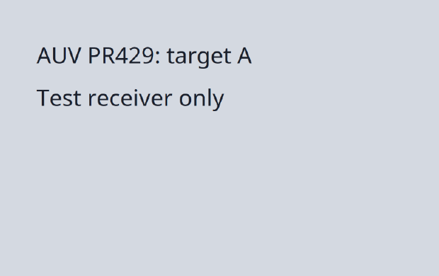

# PR #429 recovery and click sequence review

Classification: bug fix, with regression tests and contract clarification.
The reviewed head is `7cce1d93bbcdd2ccf8405dd943879f6e8528282b`.
The PR merge base is `825a6330325848594796f2d6d599d3f751b4defb`.
This note describes the follow-up changes that accompany it.

## Review outcomes

| Review | Change | Evidence |
| --- | --- | --- |
| [4403271085: unsupported Linux recovery](https://github.com/moeru-ai/auv/pull/429#discussion_r4403271085) | Unsupported guards return `UNIMPLEMENTED`, without a recapture instruction. Refusal events request `change_target`. | Handler and admission regressions, plus the full native daemon route. |
| [4403372886: invalid coordinates](https://github.com/moeru-ai/auv/pull/429#discussion_r4403372886) | Coordinate validation returns `invalid_input` with or without `--capture`. | Routed client regressions for window, screen-to-window, and display coordinates. Native CLI evidence covers all three coordinate bases, with and without a capture. |
| [4403200221: repeated clicks](https://github.com/moeru-ai/auv/pull/429#discussion_r4403200221) | Documentation states that one check admits the entire click operation. | Admission fixtures cover two and 255 presses, with target A changing to B after the first press. Native delivery confirms A then B for two, three, and 255 presses. |
| [6474897189: daemon and recording coverage](https://github.com/moeru-ai/auv/pull/429#issuecomment-6474897189) | Native checks use CLI, daemon routing, the child Runner, and production recording. | Capture artifacts, input RPC records, refusal events, and frontend command failures share one Run. |

## CLI changes

| Command | Reviewed head | Follow-up behavior |
| --- | --- | --- |
| `auv --run RUN invoke input.clickPoint 5 5 --target window:WINDOW --capture CAPTURE` on Linux | `recapture_required` with a new-capture instruction. | `unsupported`, with a display-capture/screen-coordinate alternative. |
| `auv --run RUN invoke input.clickPoint 9999 100 --target display:DISPLAY --capture CAPTURE` outside display bounds | `recapture_required`, with underlying `command_failed`. | `invalid_input`, before any input RPC. Without `--capture`, the same invalid input also returns `invalid_input`. |
| `auv --run RUN invoke input.clickPoint 800 500 --capture CAPTURE --click-count 2 --click-interval-ms 250` | One admission check before both clicks. | Same behavior. Help and API documentation now state the sequence boundary. |

The command examples use placeholders and host-specific coordinates.
No automatic retry or unguarded fallback is added.
Unsupported frontend target resolution also retains its existing `unsupported` category.

## Protobuf / Runner API changes

There are no Protobuf schema, field, or RPC signature changes.
Runner refusal behavior changes for unsupported checks:

- The Linux window-target gate returns `UNIMPLEMENTED` before target lookup or delivery.
- AT-SPI crop references return `UNIMPLEMENTED`, including when their stored baseline is unavailable.
- Unsupported recapture capabilities retain this category instead of entering capture recovery.
- The refusal event retains `CHECK_UNAVAILABLE` as its reason and records `cause_code: 12` and `recovery: "change_target"`.
- These responses contain no `ClickPreconditionFailure` detail. Other evidence refusals retain their existing rich-error contract.

Rust uses the existing unsupported client-error category. JavaScript retains the original `AuvRpcError` with code 12.
CLI and MCP use their existing `unsupported` category. No public API is added or removed.
Callers must handle this capability error separately from recoverable capture-precondition failures.

## Automated evidence

Before production changes, the Linux regression returned `FAILED_PRECONDITION` instead of `UNIMPLEMENTED`.
The coordinate regression returned `command_failed` for the unguarded bounds error.
The guarded path used the same error through unconditional recapture recovery.

After the changes, these checks passed:

```sh
export LIBCLANG_PATH=/usr/lib/x86_64-linux-gnu/libclang-21.so.21
export CLANG_PATH=/usr/bin/clang-21
cargo test -p auv-cli -p auv-cli-invoke -p auv-core -p auv-api-proto --offline
cargo check --offline
cargo fmt --check
git diff --check
cargo run --quiet --offline -- invoke --help
```

The test command passed 494 tests, with one existing ignored test.
Socket tests ran outside the filesystem sandbox. Existing platform warnings remain.
The native executable used a debug build of the same production changes.

The host default, Clang 22, produced opaque SPA types with the dependency's older bindgen.
The installed Clang 21 library and executable resolved that build failure.
Both variables are necessary to keep header discovery consistent.
The [upstream compatibility explanation](https://git.zx2c4.com/linux-rng/commit/scripts?id=dc01dfb37b34beeefcfe1c3055364d41a4070c7e) describes the forward-declaration change.
No dependency or system installation changed for this workaround.

## Native daemon and recording evidence

The host used Ubuntu 26.10, Linux `7.3.0-9-generic`, GNOME Shell 51.0, and PipeWire 1.6.8.
The existing Wayland session supplied Portal capture. No compositor or remote viewer was created.
GNOME logs reported GBM renderers for two DRM devices. The exact GPU and buffer allocation type were not measured.
The display was `eDP-1`, 2048×1152 logical points, 2560×1440 pixels, with scale 1.25.

The private daemon used `/tmp/auv-pr429-native-final.sock` and `.tmp/pr429-native-final/store`.
The test Run was `e6bce53d5cb5d36ba9cebbc691bedbbe`; it closed with outcome `succeeded`.
Commands used the normal `--run` frontend route and a daemon-owned local-driver child.
They did not call handlers directly or replace capture metadata, pixels, or the input backend.

The user allowed the RemoteDesktop Portal request and minimized the terminal to remove its changing title from the baseline.
The receiver was a normal GTK3 window through XWayland, with a close button and an Escape handler.
It changed target A to target B on the first actual button press.
The log excluded GTK's synthetic double-press notifications.



Each case captured the display, clicked through the CLI, and then retried with the same stale capture.
Each row is one native sample, not a performance or reliability estimate.

| Operation | Requested presses | Interval (ms) | Received presses / releases | Receiver targets |
| --- | ---: | ---: | ---: | --- |
| Single | 1 | 75 option | 1 / 1 | A |
| Double | 2 | 250 | 2 / 2 | A, B |
| Repeated | 3 | 150 | 3 / 3 | A, B, B |
| Maximum repeated | 255 | 75 | 255 / 255 | A, then 254 B |

The receiver recorded 261 presses and 261 releases across these four operations.
For each multi-click operation, its render-B timestamp preceded the second press.
Each stale retry returned `STATE_CHANGED`, gRPC status 9, and CLI `recapture_required`.
All four retries left the receiver event count unchanged.
This confirms that admission covers the operation once; later presses can reach the changed UI.

Successful results reported `foreground_system_events` and retained semantic verification as false.
The receiver log provides separate delivery evidence. The click result alone does not prove semantic success.
Permission setup and an ordinary control click preceded the matrix and are excluded from its counts.
The first permission-transition click reported delivery but produced only a receiver release; the later control produced a full press/release.

Eight further CLI cases left receiver events unchanged:

- A display baseline with a Linux window recipient returned `unsupported`.
- Out-of-bounds window, screen-to-window, and display coordinates returned `invalid_input`, each with and without a capture.
- An unknown capture returned `recapture_required`.

The six invalid-input cases produced no input RPC.
A public Rust SDK probe selected the receiver's exact `gjs` window ID, captured it, and fetched its PNG explicitly.
The image was 800×571 pixels and 41,497 bytes.
Its backend was `atspi.extents+xdg-desktop-portal.screencast.pipewire.crop`.
A global click with that reference returned the existing unsupported client category, without a recapture instruction.
This proves image fetchability and refusal, not correct window-crop placement.
Unsupported refusal records contain `cause_code: 12`, `recovery: "change_target"`, and `input_delivered: false`.

The [sanitized evidence summary](2026-10-29-pr-429-native-summary.json) records capture IDs, RPC spans, receiver timings, and source/log hashes.
Its assertions join successful and refused RPCs with production Runner records and frontend command records.
The tested binary includes this note's production changes on top of the reviewed head.
The summary's `reviewed_head` identifies that parent, not a clean-tree build revision.

Raw evidence remains in ignored `.tmp/pr429-native-final/`: command results, receiver source and logs, and both stores.
Runner records are under `store/runner-traces/bf96ea1be1b2099babc82d73d9c3db55e462f14dada1ace341181c19f5e012f3/records.jsonl`.
Frontend records are under `frontend-store/records.jsonl`.
Full desktop images are private local evidence. Only the test-content crop above is committed.
The Run and owned test processes are stopped.

## Evidence limits

An earlier trial in `.tmp/pr429-followup/` stopped on changing terminal metadata and a Portal permission timeout.
The successful final trial above supersedes that trial's pending native-delivery status.
It does not replace the earlier latency measurements or prove broad Linux support.
No new macOS or Windows native result is claimed.

Terminal metadata and full-frame animation can invalidate the baseline before delivery.
The contract retains exact comparison and does not add test-specific exceptions.
Per-press capture checks remain a separate policy decision because they can alter native double-click timing.
See the [current contract](2026-10-26-click-capture-precondition-contract.md) and the
[earlier native measurements](2026-10-27-pr-429-linux-review-handoff.md) for the other limits.
