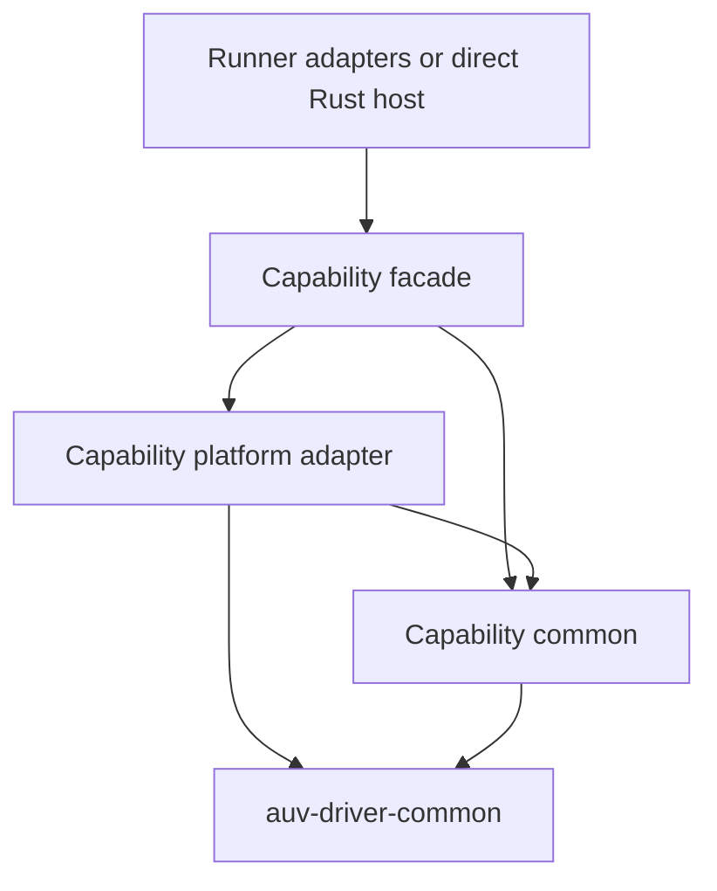

# Driver Capability Crate Split

Status: capability map accepted by the owner on 2026-11-09. The map contains
input, capture, overlay, desktop, clipboard, accessibility, and vision.
Window and display form one capability with distinct APIs. The capability name
`desktop` remains provisional. The first extraction implements portable capture
contracts and Linux display/region capture. Remaining crate names, API details,
and extraction order remain provisional.

Change classification: narrow refactor for the first extraction. This note
distinguishes implemented code from the remaining target. Evidence levels:
source inspection and automated tests. No new live platform evidence accompanies
this extraction.

## Goal

Each capability owns its typed API, reusable logic, platform adapters, and
resource lifetime. The existing overlay family provides the package pattern.
Runner adapters and direct Rust callers use the same capability implementation.

The accepted capability map contains seven capabilities. Desktop combines window
and display APIs. Clipboard, accessibility, and vision each own a separate
capability and crate family.

## Existing boundaries

| Source | Current responsibility | Consequence for extraction |
| --- | --- | --- |
| [`auv-driver-overlay`](../../../../crates/auv-driver-overlay/src/lib.rs), [`overlay-common`](../../../../crates/auv-driver-overlay-common/src/lib.rs), and platform adapters | Overlay contracts, scene logic, platform selection, and native rendering | Reuse this family structure. |
| [`auv-driver`](../../../../crates/auv-driver/src/lib.rs) | Platform selection and `LocalDriverSession` access through `Deref` | A capability must work without this aggregate. |
| [`auv-driver-common`](../../../../crates/auv-driver-common/src/lib.rs) | Shared contracts plus input controllers, motion algorithms, and remaining capability types | Capture contracts and pixel logic now live in `auv-driver-capture-common`. |
| Platform `session.rs` files | Resource-grouped APIs and reusable operation policy | Linux display capture now delegates to the independent capture provider. |
| [`LinuxDriverSessionState`](../../../../crates/auv-driver-linux/src/driver.rs) | Input, clipboard, and authorization configuration | The session retains an independent capture handle outside this state container. |
| [`MacosDriverSession`](../../../../crates/auv-driver-macos/src/driver.rs) | Window restore history | Place this history with window management. |
| [`WindowsDriverSession`](../../../../crates/auv-driver-windows/src/driver.rs) | An almost empty session aggregate | Do not require an artificial session for each capability. |
| [`local_driver.rs`](../../../../crates/auv-cli/src/runner/local_driver.rs) | Protocol conversion, service assembly, capture storage, and capability calls | Linux display capture handlers retain the capture provider directly. Other operations still use the session aggregate. |

## Crate family

Each extracted capability uses the following pattern. `input` is an example.

```text
auv-driver-input
  Platform-selecting Rust API and capability construction

auv-driver-input-common
  Portable contracts, invariants, and shared input algorithms

auv-driver-input-linux
auv-driver-input-macos
auv-driver-input-windows
  Native delivery, backend policy, resources, and platform dependencies
```

Only platforms with an existing implementation receive an adapter crate.
The facade reports unsupported operations on other targets. Empty platform
crates do not represent support.

The common crate contains shared behavior, such as mouse coordination and
scroll scheduling. It does not contain platform selection or protocol adapters.
An input-only dependency must not compile capture, OCR, or overlay backends.

The facade exposes capability operations directly. It does not require callers
to open a full `DriverSession`. A resource-owning capability can expose an
owned handle. A stateless capability can expose functions, as overlay does.
Constructor and handle names remain provisional until their extraction slice.

## Desktop capability

A capability can expose several related APIs. Window and display are two APIs
of one capability. The provisional name for this capability is `desktop`.

The proposed `auv-driver-desktop` family owns this capability. Its distinct
`window` and `display` modules share target discovery and desktop geometry.
The proposal also places existing application resolution and activation in an
`application` module. This placement avoids a separate application family.

The desktop crate owns window management and display topology. Capture owns
pixel acquisition. Input owns pointer and keyboard delivery. A desktop API can
describe a target without capturing pixels or delivering input.

## Capability inventory

All new family names in this table are provisional.

| Capability and proposed crate family | Owns | Existing code to move or classify |
| --- | --- | --- |
| `auv-driver-input` | Pointer and keyboard delivery, window-targeted input, fallback policy, holds, cancellation, timed motion, and delivery progress | The executable parts of common `input`, `keyboard`, `keyboard_input`, `mouse`, `mouse_input`, `input_cancellation`, `scroll_motion`, and `scroll_stream`. Platform input modules and input methods from `session.rs`. |
| `auv-driver-capture` | Window/display/region pixels, resolution conversion, capture origins, backend fallback, and native frame sources | Capture contracts and Linux display/region capture are extracted. macOS/Windows capture and Linux window binding remain in the platform drivers. |
| `auv-driver-overlay` | Layers, styles, themes, animation, renderer resources, and presentation thread rules | The existing overlay family. The host composes input-following presentation with input delivery. |
| Desktop: `auv-driver-desktop` | One capability with window and display APIs. Window discovery, resolution, state, focus, frame changes, restore history, and display topology. Application resolution and activation also belong here in this proposal. | Window and application modules, display discovery, Windows mutation logic, selector helpers, and related methods from `session.rs`. Capture and input methods move to their capability owners. |
| `auv-driver-accessibility` | Native trees, node queries, AX/UIA/AT-SPI actions, and semantic readback | Accessibility modules, tree bindings, AT-SPI access, and their selection logic. Actions retain `InputActionResult`. |
| `auv-driver-clipboard` | Clipboard contents, snapshots, restore, delayed rendering, ownership, and transfer lifetime | Clipboard modules and Linux clipboard portal resources. Input paste policy uses this capability. |
| `auv-driver-vision` | OCR, text matching, and existing image matching | Common `vision`, platform OCR, and vision modules. Acquisition of pixels stays with capture. The name follows the existing module vocabulary. |
| Existing media providers | Now-playing data and media controls | Retain `auv-media-macos` and existing media contracts. A media package rename is a separate decision. |

Clipboard, accessibility, and vision have distinct responsibilities:

- Clipboard owns content transfer, snapshots, restore, and delayed rendering.
  Input paste operations consume it, and direct clipboard callers also use it.
  Its transfer lifetime differs from a key press or mouse action.
- Accessibility owns native UI trees, semantic node queries, actions, and
  readback. AX, UIA, and AT-SPI dependencies belong behind this boundary.
  Both input policy and direct semantic operations consume these abilities.
- Vision owns OCR and existing image matching. It consumes images without
  requiring a desktop capture connection. Its OCR dependencies and execution
  lifetime remain separate from capture resources.

These responsibilities already exist in the platform modules. This design
records their accepted extraction into separate capability families.
The [historical API design](2026-05-25-driver-platform-api-crates-design.md)
describes namespaces, not these crate boundaries.

Permission probes stay with the capability or native boundary that owns the
permission. Combined permission and readiness reports belong to operation
composition. This proposal adds no permission or readiness family.
A `PermissionService` can retain its existing public shape.

OS login-session listing, lock, unlock, enrollment, and helper authority remain
Device responsibilities. The capability split does not redesign those APIs.

## Shared contracts and dependency direction

The existing `auv-driver-common` remains the owner of genuinely shared driver
contracts. It becomes smaller as capability logic moves.

Its shared contracts include:

- Geometry, coordinate spaces, `Position`, and target identity such as `WindowRef`.
- Target descriptions that several capabilities consume, including `Window`
  and `Display`, plus their required nested types.
- `DriverError`, `DriverResult`, and canonical delivery evidence:
  `InputActionResult`, `InputActionProgress`, `InputAttempt`, `InputDeliveryPath`,
  and `DisturbanceLevel`.
- Small shared vocabulary such as `MouseButton`, which overlay events also use.

These contracts retain their existing shapes. A source move does not create a
second window model or a second action-result schema.

The error boundary needs particular care.
[`DriverError::InputAction`](../../../../crates/auv-driver-common/src/error.rs)
contains `InputActionProgress`. Accessibility actions also return delivery
evidence. Keeping this evidence in the shared contract avoids a dependency
cycle between common errors and the input family.



Capability common crates never depend on platform adapters, Runner types,
Protobuf, `tonic`, `auv`, or CLI crates. Platform adapters never depend on the
aggregate `auv-driver` or the old platform aggregate for their implementation.
Otherwise, extraction only adds another wrapper around the existing dependency.

Native providers can use another capability for an actual external boundary.
For example, input can use clipboard transfer or accessibility delivery.
Capture can use desktop window resolution. These dependencies must remain
acyclic. Portable target descriptions do not require an executable desktop
provider.

Window and display APIs belong to the same desktop capability. Window
maximize/restore uses display work areas within that capability. Both APIs work
without a capture backend, so display discovery does not create a dependency
back to capture.

Native accessibility and desktop dependencies also need explicit direction.
Linux window discovery uses AT-SPI, while Windows accessibility currently uses
window resolution. The extraction must separate target resolution from node
operations without dependencies back to the aggregate. A family name alone does
not settle that native dependency graph.

Shared native infrastructure needs a concrete producer and consumer.
Linux portal request handling and token persistence already serve several
capabilities. Their owner is now `auv-driver-portal-linux`, with one shared
implementation. This infrastructure package does not own capability orchestration.

## API grouping and composed operations

Resource APIs can retain `window.capture()`, `window.click()`, and
`display.findText()`. Their grouping does not determine implementation ownership.
The owning operation or adapter calls the appropriate capability.

| Operation | Capability ownership |
| --- | --- |
| Capture a window | Window resolution, then capture |
| Click a window point | Input policy and delivery, with required window or accessibility access |
| Paste text | Input delivery policy plus clipboard transfer and restore |
| Find text in a window | Capture plus vision |
| Click matching text | Capture, vision, input, and separate semantic verification when required |
| Scroll until a condition | Existing scan/operation policy plus input, capture, and recognition providers |

Composition stays behind the existing typed operation boundary or its owning
domain module. Each frontend calls that boundary. CLI and gRPC adapters do not
receive separate copies of a workflow.

The existing `CaptureOptions::activation` behavior also needs classification.
Activation uses the desktop application/window API before capture. The extraction
must preserve that behavior without adding an input dependency to pixel acquisition.

## Resources and session ownership

Each capability owns the resources required by its operations. Handles retain
these resources across calls. A Runner and a direct Rust host can each own
such handles.

| Resource | Proposed owner |
| --- | --- |
| Linux input connection and selected backend | Input provider |
| Linux screencast connection and PipeWire resources | Capture provider |
| Linux clipboard connection and transfer resources | Clipboard provider |
| Portal identity and token persistence | Shared native infrastructure, with existing identity and storage policy |
| macOS maximize/restore history | Desktop provider, within its window API |
| Keyboard holds, mouse holds, and delivery arbitration | Input family, preserving current process-wide coordination |
| Overlay controller and animation resources | Overlay family |
| Retained capture pixels, `CaptureRef` lookup, and derived caches | Runner capture store |
| Recent-frame request history and buffer control | Runner frame-buffer service, using native capture sources |
| Run records and durable evidence artifacts | Existing tracing and storage owners |

The split must not create an independent hold coordinator per service instance.
Dropping one RPC object must not release another operation's keys.
Input teardown releases holds while their original native backend remains usable.

Linux capture now owns its synchronization in
[`Capturer`](../../../../crates/auv-driver-capture-linux/src/lib.rs).
Before extraction, a frame wait held the aggregate session lock. Input and
clipboard no longer need that capture lock to obtain their connections.

The design does not require a new universal `NativeSession` object.
A private backend session remains useful for an actual native lifetime.
The public aggregate session can shrink after capability providers exist.
The exact removal of `Driver`, `DriverSession`, and `LocalDriverSession` remains
a separate migration step.

## Overlay integration

The overlay family already owns renderer logic. However,
[`overlay_follow.rs`](../../../../crates/auv-driver-windows/src/overlay_follow.rs)
currently couples Windows input report sites to overlay events.

The target keeps input usable without an overlay dependency. The host connects
delivery facts to the overlay follower. The existing `MotionEvent`, input
results, and target metadata provide the starting contracts.

The follower retains existing behavior: it reports delivered actions, and
presentation errors never fail input delivery. Rendering never proves semantic
success. The host also respects the macOS renderer thread requirement.

TODO(input-overlay-delivery-hook): define the smallest typed hook for existing
Windows click and motion report sites during input extraction. A final result
alone cannot reproduce timed motion. This design does not introduce an event
bus, new action-result schema, or additional visual action classes.

## Extraction order

Each implementation slice moves production logic and its existing tests.
The sequence does not require empty crates for the complete inventory.

1. Establish shared contract ownership and the concrete dependency graph for
   the selected capability.
2. Extract only the native prerequisites that capability actually uses.
3. Move its portable contracts and algorithms into its common crate.
4. Move platform logic and native resources into capability adapters.
5. Connect direct callers and Runner adapters to the same facade.
6. Remove the migrated implementation from the old aggregate.

Capture is the first extraction. Its producer/consumer path is concrete:
native capture, typed `Capture`, direct result or Runner capture store.
Linux capture ownership exposes a specific session dependency to remove.
Portable contracts and Linux display/region capture are implemented. Input
extraction must preserve its hold lifecycle and overlay hook.

The first implementation proposal must name its platform scope. A Linux-only
extraction must not imply completion of the macOS or Windows adapters.

Temporary public re-exports require an explicit migration boundary. They must
refer to the canonical moved types and contain no second implementation.
Protobuf service names, operation IDs, and capture reference behavior remain
stable unless an implementation slice explicitly changes them.

macOS extraction includes its Swift sources, bindings, and build ownership.
New Swift packages use Swift tooling. Each touched package requires regenerated
bridge files and a SwiftPM build, in addition to Rust validation.

## First extraction: capture contracts and Linux display/region capture

The first extraction moves production logic into five crates:

| Crate | Implemented responsibility |
| --- | --- |
| [`auv-driver-capture-common`](../../../../crates/auv-driver-capture-common/src/lib.rs) | Canonical capture types, logical resolution conversion, capture origins, and display/region argument rules |
| [`auv-driver-capture`](../../../../crates/auv-driver-capture/src/lib.rs) | Capture contracts and platform selection, with a standalone provider on Linux |
| [`auv-driver-capture-linux`](../../../../crates/auv-driver-capture-linux/src/lib.rs) | Display/region acquisition, Screenshot fallback, native ScreenCast sessions, and persistent PipeWire receivers |
| [`auv-driver-desktop-linux`](../../../../crates/auv-driver-desktop-linux/src/display.rs) | Display discovery and selection, shared by capture, uinput, and existing display APIs |
| [`auv-driver-portal-linux`](../../../../crates/auv-driver-portal-linux/src/lib.rs) | Connection identity, request timeouts, consent waits, and atomic restore-token rotation |

These crates do not depend on the aggregate driver or Runner. Portal request
and persistence logic has one implementation shared by capture, input, and
clipboard. Desktop display discovery does not depend on capture.

Linux `Capturer` clones share one capture state. This state contains the native
ScreenCast session and its PipeWire receivers. The aggregate driver retains a
capture handle outside the input/clipboard mutex.

Existing direct `session.display().capture()` calls delegate to that provider.
Runner display capture, display text search, and display/region frame buffers
retain clones of the same provider. The Runner capture store still owns retained
pixels and references. Wire responses, operation IDs, and artifact handling retain
their existing behavior.

### Rust API migration

Before extraction:

```rust
use auv_driver_common::capture::{Capture, CaptureOptions, CaptureResolution};
```

After extraction:

```rust
use auv_driver_capture_common::{Capture, CaptureOptions, CaptureResolution};
```

The facade also exports these canonical types. The aggregate `auv-driver`
retains its existing root type paths during capability migration. This re-export
has no second implementation. Its removal condition is migration of aggregate
driver callers to capability APIs.

`auv-driver-common` cannot re-export capture types without a dependency cycle.
Its former `capture` module and root capture exports are removed. All workspace
consumers use the canonical capture crate or the existing aggregate facade.
The common driver crate also drops its image dependency.

A direct Linux host can create the provider without a driver session:

```rust
use auv_driver_capture::{CaptureOptions, Capturer};

let capturer = Capturer::new(Some(app_id), Some(portal_state_root))?;
let captured = capturer.capture_display(CaptureOptions::default())?;
```

The caller supplies its Portal identity and state directory. Native connections
open on authorization or first capture. Clones retain resources across calls.
The AUV aggregate still supplies its existing identity and token directory.

### Remaining boundaries

Linux window capture still owns its AT-SPI target checks and crop binding in
`auv-driver-linux::window`. It obtains display pixels from the new capture
provider. Moving that binding requires the desktop reader extraction.

macOS and Windows use the extracted capture contracts but retain their existing
native backends. The capture facade exposes a standalone provider only on Linux.
No Swift sources or FFI declarations change in this slice.

Input, clipboard, accessibility, and vision retain their existing implementations.
Inline deferral markers identify the remaining platform and window boundaries.

### Validation environment

The initial baseline fails in `libspa` before repository changes compile.
Host Clang 23 generates an opaque `spa_pod_builder` with bindgen 0.69.
Validation uses an isolated Clang 18 library through `LIBCLANG_PATH`, without
changing installed tools or project dependency versions.

The library comes from the `libclang` 18.1.1 Linux wheel on PyPI. Its SHA-256 is
`c533091d8a3bbf7460a00cb6c1a71da93bffe148f172c7d03b1c31fbf8aa2a0b`.
The validation directory is `/tmp/auv-clang18`.

```sh
LIBCLANG_PATH=/tmp/auv-clang18 cargo check --offline
LIBCLANG_PATH=/tmp/auv-clang18 cargo test --offline \
  -p auv-cli -p auv-core -p auv-cli-invoke -p auv-scan \
  -p auv-driver -p auv-driver-common -p auv-driver-capture \
  -p auv-driver-capture-common -p auv-driver-capture-linux \
  -p auv-driver-desktop-linux -p auv-driver-portal-linux \
  -p auv-driver-linux -p auv-driver-macos -p auv-driver-windows
LIBCLANG_PATH=/tmp/auv-clang18 cargo check --offline -p auv-driver-capture --no-default-features --all-targets
LIBCLANG_PATH=/tmp/auv-clang18 cargo check --offline -p auv-base-evals --all-targets
LIBCLANG_PATH=/tmp/auv-clang18 cargo run --offline --quiet -- invoke --help
cargo fmt --all --check
git diff --check
```

Native capture tests preserve pixel conversion, frame receiver reuse and recovery,
Screenshot geometry rejection, crop mapping, and fallback diagnostics.
Existing capture coordinate tests move with the canonical capture type.
Standalone-provider tests assert invalid requests before native capture.
Live desktop tests remain ignored unless their environment is available.

The affected suites passed with 1,115 tests, zero failures, and 13 ignored tests.
This run includes the root CLI suite and affected domain crates. Socket fixtures
require execution outside the filesystem/network sandbox. The capture dependency
tree excludes the aggregate driver, Runner, input backends, OCR, and overlay.

## Acceptance criteria

- The capability facade works without opening `LocalDriverSession`.
- Its native logic lives in capability crates, outside the old aggregates.
- Its dependency graph excludes unrelated capability backends and Runner code.
- Direct and Runner callers use the same implementation and canonical types.
- Existing fallback, cancellation, hold cleanup, coordinates, and error evidence
  retain their behavior.
- Capture RPCs retain references and metadata by default. Explicit image fetch
  remains the pixel-transfer boundary.
- Existing focused tests move with the code. New regression tests cover any
  behavior change. Native behavior claims link to platform evidence.
- Rust formatting, relevant builds and tests, and `git diff --check` pass.
  Each touched macOS Swift package also passes its required native checks.

## Deferred decisions

TODO(capability-provider-api): finalize constructors and method signatures for
the remaining capabilities during their extraction. The Linux capture API is
implemented in the first slice.

TODO(capability-session-migration): finalize aggregate-session removal after
the first capability works independently. A package split alone does not settle
all shared native lifetimes.

TODO(capability-extraction): continue the accepted capability extraction after
Linux display/region capture. Each slice must resolve its platform scope and
native dependencies before moving code.

TODO(capability-desktop-application): application resolution and activation
share the desktop family in this proposal. Final placement depends on the
owner's review of that family, before implementation.

TODO(capability-native-sharing): finalize macOS bridge boundaries during its
platform extraction. Portal infrastructure now lives in `auv-driver-portal-linux`.
Duplicated helpers and dependencies back to a platform aggregate are not completion.
