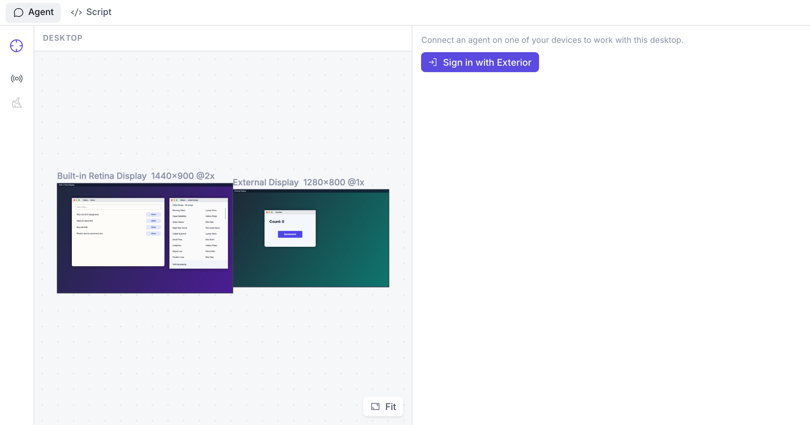
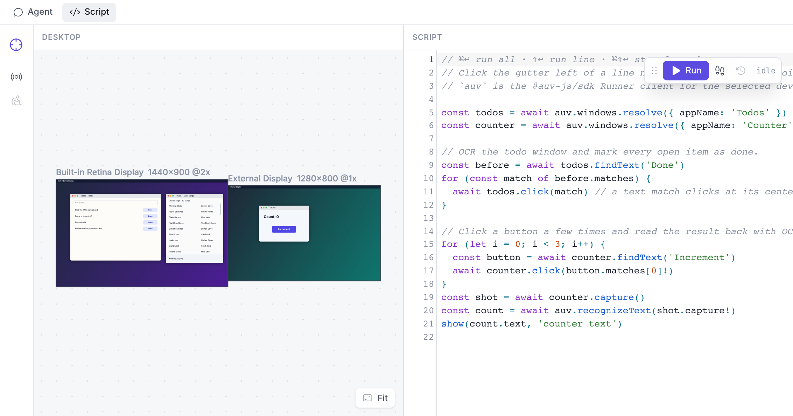

# Playground Agent presentation

Status: implemented.
This note defines Agent presentation. The [execution contract](2026-10-25-playground-http-mcp-design.md) defines transport, lifecycle, state, and validation limits.

## Presentation contract

The provisional UI label "activity" groups adjacent tool calls within one assistant message.
Narration retains its position. Groups do not combine separate messages or reorder events.
Collapsed activity shows a count, reported tool titles, and a count of returned errors.
It does not invent step names from script text.

Images and short error previews remain visible outside the folded tool list.
Image previews use bounded ACP image content.
A keyboard-accessible dialog shows the same image without an additional pixel request.

Execution details show the result before optional script and protocol sections.
Scripts retain their original text without JSON string escaping.
Full raw input, raw output, and original ACP status remain inspectable.

The activity uses the ACP tool call status. Only `failed` contributes to the issue count and error preview.
An omitted status defaults to `pending`. Both `pending` and `in_progress` display as "Running".
A `completed` call displays as "Finished" even when its raw output describes a nested failure.
The UI does not infer links to SDK Calls from script text, timing, or output strings.

The composer provides a connection indicator and a new-session action.
The chat primitive supplies a jump-to-latest control that respects manual history reading.

## Markdown and styles

Assistant text and reasoning render with assistant-ui's `MarkdownTextPrimitive`
and `remark-gfm`. The library handles streamed text and Markdown rendering.
Tool protocol data and scripts remain plain text in their detail sections.

Agent components use UnoCSS utilities and the Playground theme.
Repeated disclosure and tool-output styles use [UnoCSS shortcuts](../../../../apps/repl-playground/uno.config.ts).
[`markdown.css`](../../../../apps/repl-playground/src/features/agent/markdown.css) styles generated Markdown descendants.
Global `styles.css` contains no Agent-specific rules.

## Evidence

Evidence level: Node unit tests for tool presentation.
The [presentation unit tests](../../../../apps/repl-playground/src/features/agent/tool-presentation.test.ts) cover active calls and completed calls with errors in their output.

Evidence level: local screenshots of the Mock desktop at 1440 by 900 without a relay.
The Agent tab opens by default and shows the Exterior sign-in prompt beside the desktop.
The Script tab shows the editor in the same position.

Evidence level: one live task with OpenCode 2.0.26 through a remote Exterior Relay and the Mock desktop.
The task set Counter to two and returned a screenshot that showed `Count: 2`.
Tool calls appeared in two activity groups. The screenshot remained visible while its group was folded.
Opening and closing the preview worked.
This probe does not establish support for other agents or physical devices.

## OpenCode reference

The presentation reference is `anomalyco/opencode@32b57015e5b491a789fba1534ecb472e676c9d8e`:

- [Tool groups and execute presentation](https://github.com/anomalyco/opencode/blob/32b57015e5b491a789fba1534ecb472e676c9d8e/packages/session-ui/src/tools/tool-renderer.tsx)
- [Compact expandable triggers](https://github.com/anomalyco/opencode/blob/32b57015e5b491a789fba1534ecb472e676c9d8e/packages/session-ui/src/components/basic-tool.tsx)
