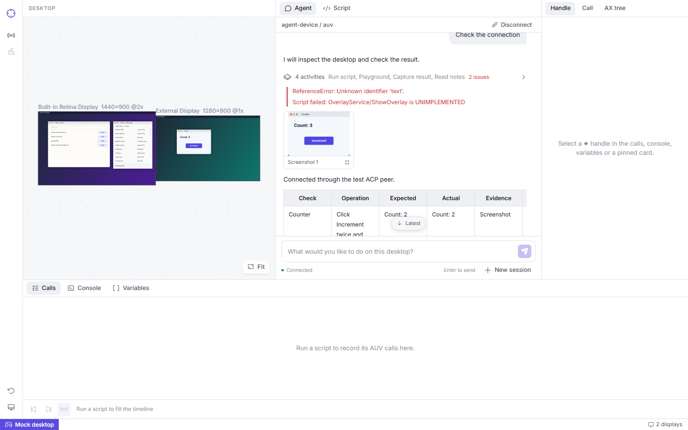

# Playground Agent presentation

Status: implemented.
This note defines Agent presentation. The [execution contract](2026-10-25-playground-http-mcp-design.md) defines transport, lifecycle, state, and validation limits.

## Presentation contract

The provisional UI label "activity" groups adjacent tool calls within one assistant message.
Narration retains its position. Groups do not combine separate messages or reorder events.
Collapsed activity shows a count, reported tool titles, and a count of returned errors.
It does not invent step names from script text.

Images and short error previews remain visible outside the folded tool list.
Image previews use bounded ACP image content.
A keyboard-accessible dialog shows the same image without an additional pixel request.

Execution details show the result before optional script and protocol sections.
Scripts retain their original text without JSON string escaping.
Full raw input, raw output, and original ACP status remain inspectable.

Returned errors use these explicit signals:

- ACP status `failed`.
- A string in `rawOutput.error`.
- OpenCode's boolean `rawOutput.metadata.error`.
- OpenCode's nested `rawOutput.metadata.toolCalls[].status === "error"`.

Output text does not determine error status.
A completed wrapper can contain a failed nested tool call.
"Finished" means that execution returned. It does not establish semantic task success.
The UI does not infer links to SDK Calls from script text, timing, or output strings.

The composer provides a connection indicator and a new-session action.
The chat primitive supplies a jump-to-latest control that respects manual history reading.

## Markdown and styles

Assistant text and reasoning use `@assistant-ui/react-markdown` with `remark-gfm`.
The library owns parsing, streamed text, and code-fence extraction.
The local adapter applies the theme, scrolls wide tables, and uses the shared clipboard helper.
Tool protocol data and scripts remain plain text in their detail sections.

Agent components use UnoCSS utilities and the Playground theme.
Repeated disclosure and tool-output styles use [UnoCSS shortcuts](../../../../apps/repl-playground/uno.config.ts).
[`markdown.css`](../../../../apps/repl-playground/src/features/agent/markdown.css) styles generated Markdown descendants.
Global `styles.css` contains no Agent-specific rules.

## Evidence

Evidence level: automated browser component tests with in-memory ACP updates, plus workbench integration with synthetic network peers and Mock Runner.
The [activity component tests](../../../../apps/repl-playground/src/features/agent/AgentActivity.browser.test.tsx) check grouped tool calls, nested failures, harmless error-related text, readable scripts, and unchanged protocol status.
They also check screenshot decoding and dialog dismissal.
The [Markdown component tests](../../../../apps/repl-playground/src/features/agent/MarkdownText.browser.test.tsx) cover tables, task lists, strikethrough, links, quotes, and fenced-code copies.
The [connection integration test](../../../../apps/repl-playground/agent/connection.browser.test.tsx) checks connection retention, session changes, and the workbench at 1280 by 720.
The [presentation unit tests](../../../../apps/repl-playground/src/features/agent/tool-presentation.test.ts) check structured error metadata without a browser.
The execution contract records the shared validation commands and results.

The fixture shows grouped calls, deliberate errors, a screenshot preview, and a Markdown report:

Evidence level: one live task with OpenCode 2.0.26 through a remote Exterior Relay and the Mock desktop.
The task set Counter to two and returned a screenshot that showed `Count: 2`.
Tool calls appeared in two activity groups. The screenshot remained visible while its group was folded.
Opening and closing the preview worked.
This probe does not establish support for other agents or physical devices.

## OpenCode reference

The presentation reference is `anomalyco/opencode@32b57015e5b491a789fba1534ecb472e676c9d8e`:

- [Tool groups and execute presentation](https://github.com/anomalyco/opencode/blob/32b57015e5b491a789fba1534ecb472e676c9d8e/packages/session-ui/src/tools/tool-renderer.tsx)
- [Code-mode failure metadata](https://github.com/anomalyco/opencode/blob/32b57015e5b491a789fba1534ecb472e676c9d8e/packages/session-ui/src/message/current-tool-state.ts)
- [Compact expandable triggers](https://github.com/anomalyco/opencode/blob/32b57015e5b491a789fba1534ecb472e676c9d8e/packages/session-ui/src/components/basic-tool.tsx)
